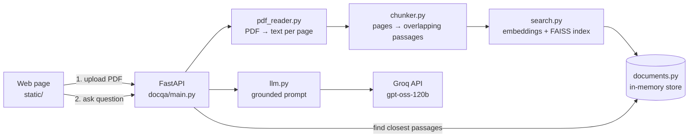

# Document Q&A

Upload a PDF and ask it questions in plain language. Every answer cites the pages it came from, and clicking a citation highlights the exact passage, so you can check the answer instead of trusting it.

Built with retrieval-augmented generation (RAG): the app finds the passages that match your question, then asks a large language model to answer **using only those passages**. When the document doesn't contain the answer, it says so.

**Live demo:** _add your Hugging Face Space link here after deploying_

## Features

- Upload any text-based PDF (up to 10 MB and 100 pages), or try the built-in sample handbook.
- Answers cite page numbers. Click a citation to highlight the passage it came from.
- Says "I don't know based on the provided document" instead of guessing.
- Each upload is private to the person who made it and is forgotten after an hour without use.
- Limits on file size, pages, question length and request rate protect the server and the AI quota.
- Works on desktop and mobile, in light and dark mode.

## How it works



**When you upload a PDF**

1. `pdf_reader.py` reads the text of each page with PyMuPDF, straight from memory.
2. `chunker.py` cuts each page into passages of 100 words that overlap by 20 words. Each passage keeps its page number.
3. `search.py` turns every passage into 384 numbers (an *embedding*) with the `all-MiniLM-L6-v2` model, and stores them in a FAISS index. Passages with similar meaning get similar numbers.
4. `documents.py` keeps the passages and index in memory under a random ID that is returned to the browser.

**When you ask a question**

1. The question is embedded the same way, and FAISS finds the 5 passages closest in meaning.
2. `llm.py` sends those passages, numbered `[1]` to `[5]` with their pages, to the AI with strict rules: answer only from the sources, cite them, and say "I don't know" if they don't contain the answer.
3. The browser turns citations like `[2]` into page marks such as **p. 4**, and shows the passages behind them.

## Tech stack

| Part | Choice | Why |
|---|---|---|
| Backend | Python, FastAPI | Typed request validation, automatic API docs at `/docs`, simple to test |
| PDF text | PyMuPDF | Fast, reliable text extraction, reads from memory |
| Embeddings | sentence-transformers `all-MiniLM-L6-v2` | Free, runs on a CPU, document text never leaves the server for this step |
| Vector search | FAISS (`IndexFlatIP`) | Exact cosine-similarity search, more than fast enough for one document |
| Answer generation | Groq API, `openai/gpt-oss-120b` | Fast responses with a free tier |
| Frontend | HTML, CSS and JavaScript | No build step; FastAPI serves it, so the whole app deploys as one container |
| Tests | pytest with a fake embedder and fake AI | Runs in under a second, needs no internet or API key |
| Deployment | Docker on Hugging Face Spaces | The free tier has 2 vCPUs and 16 GB RAM, enough for the embedding model |

## Design decisions

These are the choices that shaped the project, and what each one trades away.

1. **Retrieve, then generate.** Sending a whole PDF to the AI is slow, costly and hits length limits. Sending only the 5 most relevant passages keeps answers fast and makes them checkable, because every fact points to a passage. *Trade-off:* questions about the whole document ("summarise everything") only see 5 passages.
2. **Chunk page by page.** Each passage stays on one page, so every citation can name a real page. *Trade-off:* a sentence that crosses a page break is split in two.
3. **Overlapping chunks.** Neighbouring passages share 20 words, so an idea that sits on a boundary still appears whole in at least one passage.
4. **Local embedding model.** It's free and private, and it's small enough for a CPU. *Trade-off:* it works best in English and is less precise than large hosted embedding models.
5. **Exact search with FAISS.** With normalised vectors, `IndexFlatIP` is exact cosine similarity. A 100-page PDF yields only a few hundred passages, so exact search takes milliseconds. Large collections would need an approximate index or a vector database.
6. **Grounding rules in the prompt.** The AI must answer only from numbered sources, cite them, and use one exact "I don't know" sentence, which the page detects and styles. Temperature is 0.1 for steady answers.
7. **Prompt-injection guard.** Document text is wrapped in `<sources>` tags, and the AI is told to treat it as content, not instructions. This lowers the risk from a PDF that contains "ignore your rules", but no prompt can remove it completely.
8. **One random ID per upload.** The first version kept one shared document for everyone, so a second visitor replaced the first visitor's PDF. Now each upload gets an unguessable ID, and documents expire after an hour without use, with at most 50 kept at once.
9. **Nothing written to disk.** PDFs are processed in memory. The upload is checked by its content (`%PDF-`), not its file name, and users only ever see plain error messages, never stack traces.
10. **Limits for a public demo.** Size, page and question-length limits, plus hourly rate limits per visitor and overall, stop one person from exhausting the free AI quota.
11. **Safe rendering.** AI output is untrusted text, so the page escapes it before adding its own markup (paragraphs, lists and citation buttons).

## Limitations and next steps

- **Scanned PDFs** have no text layer. Adding OCR (for example Tesseract) would cover them.
- **Memory storage** is lost when the server restarts, and it requires a single server process. A database such as PostgreSQL with pgvector would remove both limits.
- **Hybrid search.** Combining embeddings with keyword search (BM25) would find exact names and codes more reliably.
- **Sentence-aware chunking** would stop passages starting mid-sentence.
- **Streaming answers** would show text as it's written.
- **An evaluation set** of questions with known answers would measure retrieval quality when settings change.
- **User accounts** would let people keep documents between visits.

## Run it locally

Requires Python 3.11 or newer and a free [Groq API key](https://console.groq.com/keys).

```bash
python3 -m venv .venv
source .venv/bin/activate            # Windows: .venv\Scripts\activate
python -m pip install -r requirements-dev.txt
cp .env.example .env                 # then put your key after LLM_API_KEY=
python -m uvicorn docqa.main:app --reload
```

Open http://127.0.0.1:8000 for the app, or http://127.0.0.1:8000/docs for the interactive API docs. The first start downloads the embedding model (about 90 MB).

Run the tests:

```bash
python -m pytest
```

## Deploy to Hugging Face Spaces

1. Create a free account at huggingface.co, then **New Space**. Choose the **Docker** SDK, the **Blank** template and the free **CPU basic** hardware.
2. In the Space's **Settings**, add a **secret** named `LLM_API_KEY` with your Groq key. Secrets stay private and are not copied when someone duplicates the Space.
3. Create a Hugging Face access token with **write** permission (Settings → Access Tokens).
4. Push this repository to the Space:
   ```bash
   git remote add space https://huggingface.co/spaces/YOUR-USERNAME/YOUR-SPACE-NAME
   git push --force space main
   ```
   When asked for a password, paste the access token. `--force` is only needed the first time, to replace the placeholder README the Space starts with.
5. Watch the build in the Space's **Logs** tab (the first build takes several minutes). The app then runs at `https://YOUR-USERNAME-YOUR-SPACE-NAME.hf.space`.

Free Spaces go to sleep when unused, so the first visit after a while takes a minute to wake up.

The same `Dockerfile` runs on any Docker host:

```bash
docker build -t document-qa .
docker run -p 7860:7860 --env-file .env document-qa
```

## API

| Method | Path | Purpose |
|---|---|---|
| `GET` | `/api/health` | Returns `{"status": "ok"}` |
| `GET` | `/api/limits` | Upload and question limits, so the page can show them |
| `POST` | `/api/documents` | Upload a PDF (form field `file`). Returns `document_id`, `filename`, `pages`, `chunks` |
| `POST` | `/api/documents/{document_id}/ask` | Body `{"question": "..."}`. Returns `answer` and `sources` (number, page, score, text) |

Errors return `{"detail": "message"}` with status 400 (bad input), 404 (unknown or expired document), 413 (file too large), 429 (rate limit) or 502 (AI service failed).

## Configuration

Set these as environment variables, or in `.env` when running locally.

| Variable | Default | Meaning |
|---|---|---|
| `LLM_API_KEY` | none | Groq API key (required) |
| `LLM_MODEL` | `openai/gpt-oss-120b` | Groq model that writes answers |
| `CHUNK_SIZE` / `OVERLAP` | `100` / `20` | Words per passage, and words shared between neighbours |
| `TOP_K` | `5` | Passages sent to the AI per question |
| `MAX_UPLOAD_MB` / `MAX_PAGES` | `10` / `100` | Upload limits |
| `MAX_QUESTION_CHARS` | `500` | Longest allowed question |
| `MAX_DOCUMENTS` / `DOCUMENT_TTL_MINUTES` | `50` / `60` | Documents kept in memory, and how long an unused one lasts |
| `UPLOADS_PER_CLIENT_PER_HOUR` | `10` | Per-visitor upload limit |
| `QUESTIONS_PER_CLIENT_PER_HOUR` | `30` | Per-visitor question limit |
| `QUESTIONS_PER_HOUR_TOTAL` | `300` | Question limit across all visitors |

## Project structure

```
docqa/
  main.py          FastAPI app: API routes and the web page
  config.py        Settings, read from environment variables
  pdf_reader.py    PDF bytes → text per page
  chunker.py       Pages → overlapping passages with page numbers
  search.py        Embeddings and the FAISS index
  llm.py           Grounded prompt and the Groq call
  pipeline.py      Read → chunk → index, for one upload
  documents.py     In-memory document store with expiry
  rate_limit.py    Per-visitor and overall rate limits
static/            The web page (HTML, CSS, JavaScript) and the sample PDF
tests/             pytest tests (no internet or API key needed)
scripts/           Builds the sample PDF
learning/          The original step-by-step scripts this app grew from
Dockerfile         Container for Hugging Face Spaces or any Docker host
```

## How the project grew

The app was built in stages, and each stage's script lives on in a module:

| Stage | Original script (in `learning/`) | Became |
|---|---|---|
| 1. Read a PDF | `extract_pdf.py` | `docqa/pdf_reader.py` |
| 2. Split into chunks | `chunker.py` | `docqa/chunker.py` |
| 3. Semantic search | `search_document.py` | `docqa/search.py` |
| 4. Grounded answers | `answer_question.py` | `docqa/llm.py` |
| 5. Web page | `app.py` (Streamlit) | `static/` |
| 6. API | `api.py`, `pipeline.py` | `docqa/main.py`, `docqa/pipeline.py` |
